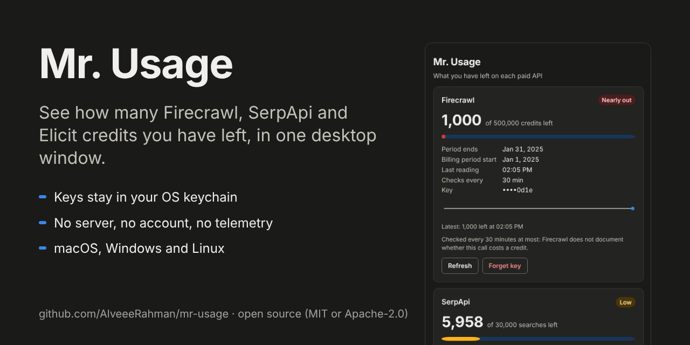

# Mr. Usage: a desktop API credit monitor

[](https://github.com/AlveeeRahman/mr-usage/actions/workflows/ci.yml)
[](https://github.com/AlveeeRahman/mr-usage/actions/workflows/smoke.yml)
[](https://github.com/AlveeeRahman/mr-usage/releases)
[](#license)

Documentation: [alveeerahman.github.io/mr-usage](https://alveeerahman.github.io/mr-usage/) · by the author of [LLM Dogfight](https://alveeerahman.github.io/llm-dogfight/), [Skill Vision](https://alveeerahman.github.io/skill-vision/), [Agent Oracle](https://alveeerahman.github.io/agent-oracle/) and [Research Hound](https://alveeerahman.github.io/research-hound/).



Mr. Usage is a small desktop app that shows, in one window, how much of each paid API you have left. It currently supports Firecrawl, SerpApi and Elicit. The numbers in the picture are each vendor's documented example response, not a real account.

You paste an API key once. The key goes into your operating system's credential store. From then on the app polls each vendor's usage endpoint and shows remaining credits, plan size, the renewal date and today's history.

There is no server, no account, no telemetry and no update check. The only network traffic is the usage call to each vendor you added a key for.

## What it stores, and where

| What | Where | How long |
| --- | --- | --- |
| API keys | macOS Keychain, Windows Credential Manager, or the Secret Service on Linux (GNOME Keyring, KWallet, KeePassXC), under the service name `mr-usage` | Until you press Forget key |
| Settings (poll interval, which providers are on, theme) | A small `settings.json` in the app's config folder | Until you delete it |
| Usage numbers and history | Memory only | Wiped at local midnight, when you press Wipe history now, and when the app quits |

The app itself writes no other files, but the system webview does. On Linux its scratch folder lives in `$XDG_RUNTIME_DIR` (a RAM disk only you can read. The system temp folder if that variable is unset) and is deleted on exit. On Windows, WebView2 keeps a working folder in `%LOCALAPPDATA%\io.github.alveeerahman.mr-usage`, and on macOS WebKit may create folders under `~/Library/Caches` and `~/Library/WebKit`. Neither is removed on exit yet (see `docs/FOLLOWUPS.md`).

Mr. Usage cannot protect you from anyone who can run programs as you. Your OS credential store hands keys to processes running under your account, and Mr. Usage cannot change that. If your account is compromised, rotate your API keys.

## Install

Download the file for your platform from [GitHub Releases](https://github.com/AlveeeRahman/mr-usage/releases), then check it against `SHA256SUMS.txt` from the same release:

```sh
# macOS / Linux
shasum -a 256 <downloaded file>        # compare with SHA256SUMS.txt
# Windows (PowerShell)
Get-FileHash <downloaded file> -Algorithm SHA256
```

### macOS

Open the `.dmg` (`aarch64` for Apple silicon, `x64` for Intel) and drag Mr. Usage to Applications.

The build is not signed or notarized with an Apple Developer ID, so the first time you open it Gatekeeper warns that it cannot verify the developer or that the app is free of malware ([Apple: Safely open apps on your Mac](https://support.apple.com/en-us/102445)). After checking the SHA-256 sum, remove the quarantine flag and open it:

```sh
xattr -dr com.apple.quarantine "/Applications/Mr. Usage.app"
```

You can instead open System Settings → Privacy & Security and choose Open Anyway.

### Windows

Run the `*-setup.exe` (installs for your user only) or the `.msi` (installs for all users, needs admin rights). SmartScreen may warn that the publisher is unknown, because the installer is not code-signed. Choose More info → Run anyway once you have checked the SHA-256 sum.

### Linux

```sh
sudo apt install "./Mr. Usage_0.1.0_amd64.deb"         # Debian, Ubuntu
sudo dnf install "./Mr. Usage-0.1.0-1.x86_64.rpm"      # Fedora, RHEL
chmod +x "Mr. Usage_0.1.0_amd64.AppImage" && "./Mr. Usage_0.1.0_amd64.AppImage"   # anything else
```

The AppImage needs FUSE 3 (the `fuse3` package). Without it you can run it with `APPIMAGE_EXTRACT_AND_RUN=1`, but the AppImage runtime then leaves its extracted copy in `/tmp/appimage_extracted_*` after the app exits (behaviour of the runtime Tauri embeds, not of Mr. Usage). Delete that folder, or use the `.deb` or `.rpm`.

You need a running Secret Service provider: GNOME Keyring (default on GNOME), KWallet (KDE) or KeePassXC with its Secret Service integration turned on. Without one, Mr. Usage shows an error and stores nothing. It will never fall back to a file.

## Uninstalling

1. In the app, press Forget key on each card. That deletes the keys from your credential store. Uninstalling the app does not do this for you, because your OS treats keys as your data, not the app's.
2. Remove the app:
   - macOS: drag `/Applications/Mr. Usage.app` to the Trash.
   - Windows: Settings → Apps → Mr. Usage → Uninstall (or `msiexec /x` for the MSI).
   - Linux: `sudo apt purge mr-usage`, `sudo dnf remove mr-usage`, or delete the AppImage.
3. Optional: delete the settings folder, which uninstallers leave alone by convention. It holds no keys and no usage data.
   - macOS: `~/Library/Application Support/io.github.alveeerahman.mr-usage`
   - Windows: `%APPDATA%\io.github.alveeerahman.mr-usage` and `%LOCALAPPDATA%\io.github.alveeerahman.mr-usage` (the second is the WebView2 runtime's working folder)
   - Linux: `~/.config/io.github.alveeerahman.mr-usage`

If you skipped step 1, delete the entries named `mr-usage` in Keychain Access (macOS), Credential Manager (Windows), or Seahorse / KWallet Manager (Linux). On Linux, `secret-tool clear service mr-usage` also works.

## Using it

- Add provider: pick a provider, paste the key, press Save key. The panel shows the exact URL that will be called and the documentation page it was checked against. The field clears as soon as you save.
- Cards: remaining out of limit, a bar, the renewal or period-end date, when the last reading came in, and a line of today's readings. A Low badge appears under 20% and Nearly out under 5%.
- Settings: poll interval (each provider keeps its own minimum, shown on its card), theme, and Wipe history now.

| Provider | Endpoint | Minimum interval | Notes |
| --- | --- | --- | --- |
| Firecrawl | `GET https://api.firecrawl.dev/v2/team/credit-usage` | 30 min | Firecrawl does not document whether this call costs a credit, so it is polled sparingly. |
| SerpApi | `GET https://serpapi.com/account.json` | 1 min | Free. Does not count against your searches. SerpApi only accepts the key as a URL parameter. The app keeps that URL out of every log and error. |
| Elicit | `GET https://elicit.com/api/v2/usage` | 1 min | Elicit reports a percentage of plan usage, not a count. Needs a Pro plan or above. |

## Security model in brief

The full version is in [`docs/THREAT_MODEL.md`](docs/THREAT_MODEL.md).

- Keys are written only to the OS credential store, read at fetch time, wrapped in `secrecy::SecretString` and zeroized on drop. They are never cached in app state and never sent back to the window.
- HTTP goes through rustls (ring provider), TLS 1.2 or newer, HTTPS only, redirects off, a 15-second timeout and a per-provider host allowlist checked before each request. Response bodies are capped at 64 KiB and zeroized.
- Every log line passes through a redaction layer. The default level is `warn`.
- The window runs a strict Content Security Policy (no inline scripts, no remote origins, `connect-src 'none'`), cannot load any page outside the app, has devtools compiled out of release builds, and can call only the eight commands listed in `src-tauri/capabilities/main.json`, plus listening for the app's update event. No HTTP, shell, filesystem or opener plugin is included.
- On Linux the process disables core dumps and marks itself non-dumpable at startup.
- `SIGTERM`, `SIGINT` and closing the window all take the same exit path: history is wiped, the webview scratch folder is deleted, and the exit code is 0.
- Known residual copies of a key (the webview's input, Tauri's IPC decoding, the HTTP stack) are listed in the threat model rather than hidden.

## Building from source

Prerequisites: Rust (stable, 1.90 or newer), Node.js 20.19 or newer, and [Tauri's system prerequisites](https://v2.tauri.app/start/prerequisites/) for your OS (on Debian/Ubuntu: `libwebkit2gtk-4.1-dev libappindicator3-dev librsvg2-dev patchelf libxdo-dev libssl-dev`).

```sh
git clone https://github.com/AlveeeRahman/mr-usage.git
cd mr-usage
cargo install tauri-cli --version 2.12.3 --locked   # once
cargo tauri dev                                     # runs npm ci and the Vite dev server for you
cargo tauri build                                   # installers in target/release/bundle/
```

`npm run tauri dev` works too and uses the CLI pinned in `package-lock.json`.

### Tests and checks

```sh
cargo test --workspace                      # unit tests, redaction test, settings test, leak test, source audit
cargo clippy --workspace --all-targets -- -D warnings
cargo deny check && cargo audit -D warnings
npm audit --audit-level=low

# Linux, with an unlocked Secret Service running:
cargo test -p mr-usage-core -- --ignored --test-threads=1   # real keystore round trip + leak scan
bash scripts/leak-test-linux.sh                             # core-dump leak test (needs gdb)
bash e2e/run-linux.sh                                       # drives the real app through WebDriver

# Installer smoke tests (what CI runs on every push):
bash scripts/smoke-linux.sh deb target/release/bundle/deb/*.deb
pwsh scripts/smoke-windows.ps1 -Kind nsis -Installer <setup.exe>
bash scripts/smoke-macos.sh target/release/bundle/dmg/*.dmg
```

## Adding a provider

1. Find the vendor's documented usage endpoint. If there isn't one, stop. Mr. Usage does not scrape dashboards or call private APIs.
2. Record the URL, method, auth scheme and response fields in `docs/SOURCES.md`, with the date.
3. Copy the vendor's documented example responses, verbatim, into `crates/core/tests/fixtures/`.
4. Add `crates/core/src/providers/<name>.rs` implementing `Provider` (see `firecrawl.rs` for a Bearer-token vendor, `serpapi.rs` for a query-parameter one). Deserialize only the numbers you need, and leave out anything the vendor echoes back.
5. Add it to `registry()` in `providers/mod.rs`. The UI picks it up automatically.
6. Run the tests. The registry test checks the endpoint is on the provider's own host allowlist.

## Project layout

```
crates/core/       providers, keystore, redaction, HTTP, poller, wipe, settings (no Tauri; plain cargo test)
src-tauri/         the Tauri shell: commands, capabilities, CSP, window, signal handling
src/               the frontend (TypeScript, no framework)
e2e/               end-to-end test of the real app
scripts/           leak test and installer smoke tests
docs/              threat model, sources, review, follow-ups
```

## License

Dual-licensed under [MIT](LICENSE-MIT) or [Apache-2.0](LICENSE-APACHE), at your option. Every dependency is open source, and `deny.toml` enforces the license allowlist.
