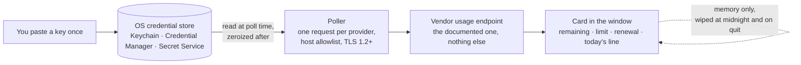

<p align="center">
  <a href="https://alveeerahman.github.io/mr-usage/"></a>
</p>

# Mr. Usage: a desktop API credit monitor

[](https://github.com/AlveeeRahman/mr-usage/actions/workflows/ci.yml)
[](https://github.com/AlveeeRahman/mr-usage/actions/workflows/smoke.yml)
[](#license)
[](https://www.rust-lang.org/tools/install)
[](https://v2.tauri.app/)
[](#install)

**Documentation**: [alveeerahman.github.io/mr-usage](https://alveeerahman.github.io/mr-usage/)

**mr-usage** is one window that shows how much of each paid API you have left: 44 providers
across search and scraping, research and data, LLM inference, speech and media, compute,
quantum and SEO, from Firecrawl, SerpApi and OpenRouter to DeepSeek, ElevenLabs, RunPod,
Azure Quantum and Ahrefs. Every card reads the vendor's own documented usage endpoint with
your ordinary key: no admin keys, no cookies, no private endpoints, and no call that costs
money. Paste a key once.
It goes into the credential store your operating system already has (Keychain on macOS,
Credential Manager on Windows, GNOME Keyring or KWallet on Linux) and never comes back to
the window. The app has no account, no server and no analytics. The only thing it talks to
is the usage page of each vendor you gave it a key for.


## Install

macOS or Linux, in a terminal:

```sh
curl -fsSL https://raw.githubusercontent.com/AlveeeRahman/mr-usage/main/installers/install.sh | sh
```

Windows, in PowerShell:

```powershell
irm https://raw.githubusercontent.com/AlveeeRahman/mr-usage/main/installers/install.ps1 | iex
```

The command downloads the right package for your machine, checks it against the release's
checksum list, installs it, and clears the "downloaded from the internet" flag so the app
opens without a detour through security settings. Then open Mr. Usage from Launchpad, the
Start menu or your application menu.

<details>
<summary>Install by hand instead</summary>

Download from [Releases](https://github.com/AlveeeRahman/mr-usage/releases/latest):

| Your computer | File |
| --- | --- |
| Mac with Apple silicon (M1 or later) | `..._aarch64.dmg` |
| Mac with an Intel chip | `..._x64.dmg` |
| Windows | `..._x64-setup.exe` (installs for your user, no admin needed) |
| Debian, Ubuntu, Mint | `..._amd64.deb` |
| Fedora, RHEL | `....x86_64.rpm` |
| Other Linux | `..._amd64.AppImage` (needs FUSE) |

The builds are not yet signed with an Apple or Microsoft certificate, so each system asks once:

- macOS says it cannot verify the developer. Open System Settings, click Privacy & Security, scroll down and click Open Anyway, as Apple describes in [Safely open apps on your Mac](https://support.apple.com/en-us/102445).
- Windows shows a SmartScreen notice. Click "More info", then "Run anyway".
- Linux installs with `sudo apt install ./<file>.deb`, `sudo dnf install ./<file>.rpm`, or `chmod +x <file>.AppImage` and run it.

</details>

## How it works



## First run

1. Open Mr. Usage. The "Add provider" panel is open on first run.
2. Pick a provider, paste its API key and press Save key. The panel shows the exact web address the app will call for that provider. The field clears as soon as the key is saved.
3. A card appears and fills in within about 15 seconds: what is left, out of what, when the plan renews, and a line showing today's readings.

Repeat for each provider you use. A card gets a yellow "Low" badge under 20% left and a red "Nearly out" badge under 5%.

**Search and scraping**

**Search and scraping**

**Search and scraping**

| Provider | What the card shows |
| --- | --- |
| Firecrawl | Credits left out of the plan, and the end of the billing period |
| SerpApi | Searches left this month, and the renewal date |
| Tavily | Credits left out of the plan, plus this key's own usage |
| Apify | Dollars left of this month's spending limit |
| Brave Search | Searches left this month of the plan's monthly quota, and when the month resets |
| SearchApi.io | Search credits left this month of the monthly allowance, the subscription period end, searches used this month and this hour |
| ScrapingBee | API credits left of the plan's credits, the renewal date, and current concurrency |
| Bright Data | Account funds in dollars, this period's pending costs, and any credit or prepayment |
| Linkup | The prepaid credit balance in dollars |
| Crawlbase | Crawling API credits left this month on a subscription, or this month's amount due in dollars on pay as you go, with successful and failed request counts |

**Research and data**

| Provider | What the card shows |
| --- | --- |
| Elicit | Percentage of the plan left |
| Context7 | Requests left this month, and extra-request cost on paid plans |
| Hunter | Searches left, plus verifications and the credit pool where the plan has one |

**LLM inference**

| Provider | What the card shows |
| --- | --- |
| OpenRouter | Dollars left on the key's credit limit (a key without a limit shows the workspace budget, or else the month's spend) |
| DeepSeek | The account's remaining balance in the currency DeepSeek bills you in (yuan or dollars), with the granted and topped-up parts as extras and a flag when inference is blocked |
| Moonshot (Kimi) | The spendable balance (cash plus vouchers) in dollars, with voucher and cash balances as extras; a negative cash balance shows as debt |
| Vercel AI Gateway | The team's remaining AI Gateway credit in dollars, plus "Used so far" (lifetime spend, not this month's) |
| Novita AI | The spendable balance in dollars; when the account has a credit line it is shown as the limit, with the top-up balance and any amount owed as extras |
| SiliconFlow | The total balance in dollars, with the granted and topped-up parts as extras |
| xAI | The team's prepaid credit balance in dollars (postpaid usage and spending limits are not shown) |

**Speech and media**

| Provider | What the card shows |
| --- | --- |
| Runway | The organization's credit balance |
| fal.ai | The account's remaining credit balance in dollars |
| ElevenLabs | Characters left out of the plan's character limit for the current billing period, with the next reset date, the plan tier, and any usage-based overage spend |
| Deepgram | The project's outstanding prepaid balance in US dollars, adding up every balance whose units are USD |
| D-ID | Credits remaining out of the total across the account's credit pools, with the renewal date set to when the first pool that still has credits expires |
| HeyGen | Whichever the account uses: the prepaid wallet balance (dollars or credits), the subscription's premium credits with their reset date, or the metered spend against its cap |
| Stability AI | The account's credit balance rounded down, with the exact fractional balance as an extra |
| Black Forest Labs | The account's credit balance rounded down, with the exact fractional balance as an extra when it is not whole |
| Luma | The Dream Machine credit balance in US dollars (the API reports cents) |
| Recraft | The account's remaining Recraft credits |

**Compute**

| Provider | What the card shows |
| --- | --- |
| RunPod | The prepaid RunPod balance in dollars, the current hourly burn rate, and the account spend limit when one is set |
| Vast.ai | The account's prepaid balance in dollars; a negative balance shows as zero left with an "Owed" line |
| DigitalOcean | Account credit left (when the balance is negative) and this month's usage in dollars, with any amount owed and the month-to-date balance as lines |

**Quantum**

| Provider | What the card shows |
| --- | --- |
| Azure Quantum | The largest free job-hours quota of the workspace in seconds, what is used and held against it, when it resets, and the other quota rows (FPGA hours, concurrent jobs) as lines |
| IBM Quantum | Nothing yet; the card explains that IBM Quantum needs an IAM token exchange on a second host |

**SEO and marketing**

| Provider | What the card shows |
| --- | --- |
| Ahrefs | API units left of the key's monthly limit, or of the workspace pool when the key has no limit of its own, and the day the count resets |
| Moz | Rows left of the month's Data API quota, and when the period resets |
| Semrush | Standard API units left on the balance; Semrush reports no limit or renewal date |
| SE Ranking | Data API units left of the subscription total, with the subscription expiry as the renewal date |
| Serpstat | API credits (result lines) left of the plan's maximum; Serpstat reports no renewal date |
| Mangools | SERP lookups left of the pool's limit and when it resets, with the other pools listed below |
| DataForSEO | Account balance in dollars, with total deposits, today's spend and the daily and per-minute spending limits below |
| Majestic | Retrieval units left on the balance, with analysis and index-item units below; the earliest subscription expiry is the renewal date |
| Keywords Everywhere | Prepaid credits left on the balance; the vendor reports no limit or renewal date |

Each card is refreshed every 5 minutes, and Settings lets you pick anything from 1 minute to 24 hours. Changing the interval takes effect from the last poll, so dropping from an hour to a minute does not wait an hour. Every one of these calls reads your account's own usage page. SerpApi, Context7 and Hunter document the call as free, Firecrawl's open-source server shows it bills nothing (and a live account confirmed it), and none of the other vendors list it as a billable call.

## What it keeps, and where

| | Where | Until |
| --- | --- | --- |
| API keys | Your system credential store, under the name `mr-usage` | You press Forget key, or uninstall |
| Settings (refresh interval, theme, which cards are on) | One small `settings.json` | You uninstall |
| Usage numbers and today's history | Memory only | Midnight, Wipe history now, or quitting the app |

Nothing else is written. The settings file never contains a key, an email address or a usage number.

## Command line

The app takes three options and nothing else:

```
mr-usage                 open the window
mr-usage --forget-keys   delete every key it stored, then exit (the uninstallers run this)
mr-usage --help          options, exit codes and the MR_USAGE_LOG variable
mr-usage --version
```

Anything else is refused with exit status 2. On Windows the release build has no console, so `--help` prints nothing there. The exit code still applies.

## Uninstall

macOS or Linux:

```sh
curl -fsSL https://raw.githubusercontent.com/AlveeeRahman/mr-usage/main/installers/install.sh | sh -s -- --uninstall
```

Windows:

```powershell
& ([scriptblock]::Create((irm https://raw.githubusercontent.com/AlveeeRahman/mr-usage/main/installers/install.ps1))) -Uninstall
```

This removes the keys from your credential store, then the app, then its settings. Uninstalling through the system's own "Remove program" leaves the keys in place (operating systems treat them as your data, not the app's), so press Forget key on each card first if you go that way.

## If something looks wrong

- "No Secret Service is running" (Linux): the app needs GNOME Keyring, KWallet or KeePassXC. The `.deb` and `.rpm` pull in GNOME Keyring on install. On other setups, install one and log out and in again.
- "The vendor rejected this API key": the key is wrong, expired or for a different product. Paste a fresh one from the vendor's dashboard.
- "Rate limited by the vendor": the card shows the vendor's own message and tries again later on its own.
- Elicit needs a Pro plan or above for API access. Below that, the card says so.
- The AppImage does nothing when double-clicked: install FUSE (`fuse3` on most distributions), or use the `.deb` or `.rpm`.

## What is checked on every push

| Gate | What runs |
| --- | --- |
| Lints | `cargo fmt --check` and `cargo clippy -D warnings`, with `unwrap`, `expect`, `panic!` and print macros denied outside tests |
| Tests on three operating systems | 306 tests: provider parsers against the vendors' own documented responses, log redaction, settings, an allocator that scans every freed block for the key, a source audit, and the binary's command line |
| Minimum Rust version | The core crate on Rust 1.90 with the locked dependency graph |
| Real keystore | Round trip and a core-dump leak scan against GNOME Keyring |
| End to end | The real Linux build driven through WebDriver: save a key, see it land in the Secret Service, watch the first poll |
| Supply chain | `cargo deny`, `cargo audit`, `npm audit`, lockfiles committed, actions pinned to commit SHAs |
| Installers | Build the `.deb`, `.rpm`, AppImage, `.dmg`, NSIS and MSI packages, then install, start, stop three ways and uninstall each |

## Layout

| Folder | Holds |
| --- | --- |
| `crates/core/` | Providers, keystore, redaction, HTTP, poller, midnight wipe, settings. Plain Cargo, no Tauri, so it can be audited and tested without a webview |
| `src-tauri/` | The Tauri shell: command line, the ten commands the window may call, capabilities, CSP, window, signal handling |
| `frontend/` | The window: one HTML file and three TypeScript files, no framework |
| `installers/` | `install.sh` for macOS and Linux, `install.ps1` for Windows. Each is also the uninstaller |
| `docs/` | Threat model, sources for every vendor fact, follow-ups, and the GitHub Pages site |
| `.github/` | Workflows, installer smoke tests, the end-to-end test, the leak test |

## Map of the project


## More

- How the app protects keys, and what it cannot protect you from: [SECURITY.md](SECURITY.md) and [docs/THREAT_MODEL.md](docs/THREAT_MODEL.md).
- Building from source, running the tests, adding a provider: [docs/DEVELOPMENT.md](docs/DEVELOPMENT.md).
- Where every vendor fact in the app came from: [docs/SOURCES.md](docs/SOURCES.md).

## License

MIT or Apache-2.0, your choice. See [LICENSE-MIT](LICENSE-MIT) and [LICENSE-APACHE](LICENSE-APACHE).
