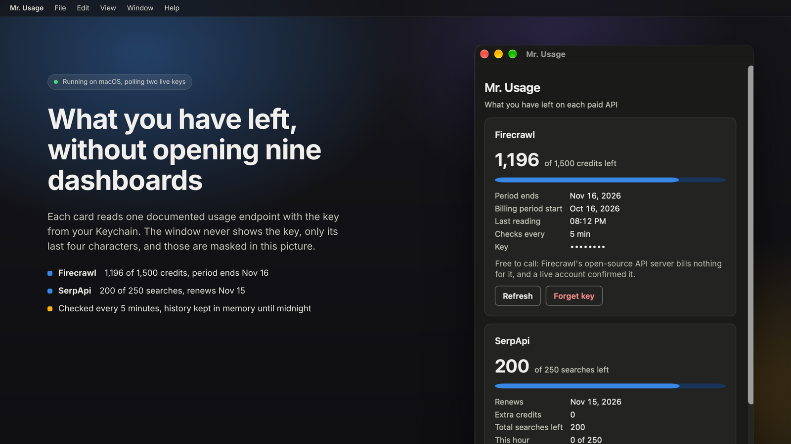
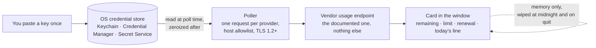
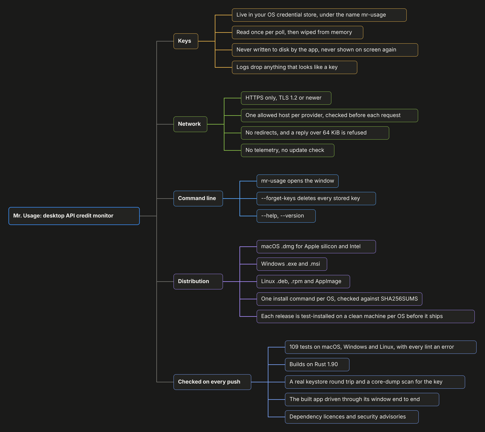

<p align="center">
  <a href="https://alveeerahman.github.io/mr-usage/"></a>
</p>

# Mr. Usage: a desktop API credit monitor

[](https://github.com/AlveeeRahman/mr-usage/actions/workflows/ci.yml)
[](https://github.com/AlveeeRahman/mr-usage/actions/workflows/smoke.yml)
[](https://scorecard.dev/viewer/?uri=github.com/AlveeeRahman/mr-usage)
[](#license)
[](https://www.rust-lang.org/tools/install)
[](https://v2.tauri.app/)
[](#install)

**Documentation**: [alveeerahman.github.io/mr-usage](https://alveeerahman.github.io/mr-usage/)

**mr-usage** is one window that shows how much of each paid API you have left: 44 providers
across search and scraping, research and data, LLM inference, speech and media, compute,
quantum and SEO, from Firecrawl, SerpApi and OpenRouter to DeepSeek, ElevenLabs, RunPod,
Azure Quantum and Ahrefs. Every card reads the vendor's own documented usage endpoint with
your ordinary key: no admin keys, no cookies, no private endpoints, and no call that costs
money. Paste a key once.
It goes into the credential store your operating system already has (Keychain on macOS,
Credential Manager on Windows, GNOME Keyring or KWallet on Linux) and never comes back to
the window. The app has no account, no server and no analytics. The only thing it talks to
is the usage page of each vendor you gave it a key for.



## Install

macOS or Linux, in a terminal:

```sh
curl -fsSL https://raw.githubusercontent.com/AlveeeRahman/mr-usage/main/installers/install.sh | sh
```

Windows, in PowerShell:

```powershell
irm https://raw.githubusercontent.com/AlveeeRahman/mr-usage/main/installers/install.ps1 | iex
```

The command downloads the right package for your machine, checks it against the release's
checksum list, installs it, and clears the "downloaded from the internet" flag so the app
opens without a detour through security settings. Then open Mr. Usage from Launchpad, the
Start menu or your application menu.

<details>
<summary>Install by hand instead</summary>

Download from [Releases](https://github.com/AlveeeRahman/mr-usage/releases/latest):

| Your computer | File |
| --- | --- |
| Mac with Apple silicon (M1 or later) | `..._aarch64.dmg` |
| Mac with an Intel chip | `..._x64.dmg` |
| Windows | `..._x64-setup.exe` (installs for your user, no admin needed) |
| Debian, Ubuntu, Mint | `..._amd64.deb` |
| Fedora, RHEL | `....x86_64.rpm` |
| Other Linux | `..._amd64.AppImage` (needs FUSE) |

Each release's checksum list is signed with Sigstore and every installer has GitHub build provenance; [SECURITY.md](SECURITY.md) shows how to verify both. The builds are not yet signed with an Apple or Microsoft certificate, so each system asks once:

- macOS says it cannot verify the developer. Open System Settings, click Privacy & Security, scroll down and click Open Anyway, as Apple describes in [Safely open apps on your Mac](https://support.apple.com/en-us/102445).
- Windows shows a SmartScreen notice. Click "More info", then "Run anyway".
- Linux installs with `sudo apt install ./<file>.deb`, `sudo dnf install ./<file>.rpm`, or `chmod +x <file>.AppImage` and run it.

</details>

## How it works



## First run

1. Open Mr. Usage. The "Add provider" panel is open on first run.
2. Pick a provider, paste its API key and press Save key. The panel shows the exact web address the app will call for that provider. The field clears as soon as the key is saved.
3. A card appears and fills in within about 15 seconds: what is left, out of what, when the plan renews, and a small chart of today's readings.

Repeat for each provider you use. A card gets a yellow "Low" badge under 20% left and a red "Nearly out" badge under 5%.

Every card has the same layout. The big figure is the main number: what you have left, counting down from the plan limit when the vendor reports one. A few vendors report spend instead of a balance, and the main number is then what you have spent this period, against the cap if there is one. Press More on a card to open its details: the renewal date, spend this period, and any extra figures the vendor reports. The tables below give both for each provider.

**Search and scraping**

| Provider | What the card shows |
| --- | --- |
| Firecrawl | Main number: credits left, out of the plan's credits. Details: the start and end of the billing period, and the overage when you have gone past zero. |
| SerpApi | Main number: searches left this month, out of the plan's monthly searches. Details: the renewal date, any extra credits, the total searches left including them, and this hour's searches against the hourly cap. An account with no monthly plan shows its total searches left instead. |
| Tavily | Main number: plan credits left, out of the plan's credits. Details: the plan name, how many credits this key alone has used, and pay-as-you-go usage against its limit when that is switched on. |
| Apify | Main number: dollars left of this month's spending limit. Details: compute units and proxy SERPs used this month, each against its own limit. |
| Brave Search | Main number: searches left this month, out of the plan's monthly quota. Details: when the month resets and the per-second rate limit. A pay-as-you-go plan has no monthly quota, and the card says so. |
| SearchApi.io | Main number: searches left this month, out of the monthly allowance. Details: when the subscription period ends, searches used this month, and searches this hour against the hourly limit. |
| ScrapingBee | Main number: API credits left, out of the plan's credits. Details: the renewal date, and how many requests are running right now against the concurrency limit. |
| Bright Data | Main number: available funds in dollars. Details: usage costs pending for the next invoice (shown as spend), plus any credit and any prepayment on the account. |
| Linkup | Main number: prepaid credit balance in dollars. Linkup reports no limit and no renewal date, so there are no details. |
| Crawlbase | Main number: on a subscription, Crawling API credits left this month; on pay as you go, this month's bill in dollars instead. Details: successful and failed requests this month, and on a subscription the amount due this month. |

**Research and data**

| Provider | What the card shows |
| --- | --- |
| Elicit | Main number: the percentage of the plan still unused, out of 100. Details: when the period ends, whether Elicit still allows usage, and extra-usage spend in dollars against its cap. |
| Context7 | Main number: requests left this month, out of the plan's included requests. Details: the plan name, when usage resets, requests made this month, and on paid plans the extra requests and their cost against the spending limit. |
| Hunter | Main number: searches left, out of the plan's searches. Details: the plan name, verifications left, and on plans with one shared credit pool the pool itself (the search count is then an estimate drawn from that pool). |

**LLM inference**

| Provider | What the card shows |
| --- | --- |
| OpenRouter | Main number: dollars left on this key's credit limit. A key with no limit shows the workspace budget instead, and with no budget either the card shows this month's spend only. Details: when the limit resets, the budget and its reset interval, free-model requests today, and whether the account is on the free tier. |
| DeepSeek | Main number: total balance, in the currency DeepSeek bills you in (yuan or dollars). Details: how much of it was granted by DeepSeek and how much you topped up, and a warning when the balance is too low to run inference. |
| Moonshot (Kimi) | Main number: spendable balance in dollars, which is cash plus vouchers. Details: the voucher balance and the cash balance separately, and a warning when inference is blocked. A negative cash balance means you owe Moonshot money. |
| Vercel AI Gateway | Main number: the team's remaining AI Gateway credit in dollars. Details: everything spent since the account opened, labelled Used so far. Vercel does not report a monthly figure. |
| Novita AI | Main number: spendable balance in dollars. When the account has a credit line, the main number counts down from that line. Details: the topped-up balance and any amount owed. |
| SiliconFlow | Main number: total balance in dollars. Details: how much of it was granted by SiliconFlow and how much you topped up. |
| xAI | Main number: the team's prepaid credit balance in dollars. Details: any amount owed. Postpaid usage and spending limits are not shown. The card needs your team id as a setting. |

**Speech and media**

| Provider | What the card shows |
| --- | --- |
| Runway | Main number: the organization's credit balance. Runway has no plan limit to count down from. Details: the monthly spend cap when one is set. |
| fal.ai | Main number: remaining credit balance in dollars. Details: a warning when the balance is below zero. |
| ElevenLabs | Main number: characters left, out of the plan's character limit for this billing period. Details: when the count resets, the plan tier, the subscription status, and any usage-based overage spend. |
| Deepgram | Main number: the project's prepaid balance in US dollars, adding up every balance on the project that is in dollars. Details: how many balances were added, and how many were skipped because they are not in dollars. The card needs your project id as a setting. |
| D-ID | Main number: credits left, out of the total across all of the account's credit pools. The renewal date is when the first pool that still has credits expires. Details: how many pools the account has. |
| HeyGen | Depends on how the account is billed. Prepaid wallet: the balance in dollars or credits, with auto-reload on or off. Subscription: premium credits left and when they reset, with the plan name and add-on credits. Usage-based: dollars spent against the spending cap. |
| Stability AI | Main number: credit balance, rounded down to a whole number. Details: the exact balance with its fraction. |
| Black Forest Labs | Main number: credit balance, rounded down to a whole number. Details: the exact balance with its fraction, when it is not a whole number. |
| Luma | Main number: Dream Machine credit balance in US dollars. Luma reports it in cents and the card converts it. |
| Recraft | Main number: Recraft credits left. Recraft reports no limit or renewal date. |

**Compute**

| Provider | What the card shows |
| --- | --- |
| RunPod | Main number: prepaid balance in dollars. Details: the current spend per hour, the account spend limit when one is set, and the amount owed when the balance is negative. |
| Vast.ai | Main number: prepaid balance in dollars. A negative balance shows as zero left, with the amount owed in the details. |
| DigitalOcean | Main number: account credit in dollars, when the account has credit. Spend this period is this month's usage. Details: any amount owed, the month-to-date balance, and the time DigitalOcean produced these figures. |

**Quantum**

| Provider | What the card shows |
| --- | --- |
| Azure Quantum | Main number: free job hours left in the workspace's largest hours quota, shown as hours and minutes, out of that quota. Details: which quota is being counted, hours on hold for queued jobs, when the month resets, and every other quota row (for example FPGA hours or concurrent jobs) as used against its limit. The card needs your workspace address as a setting. |
| IBM Quantum | No reading yet. The card explains that IBM Quantum needs a token exchange with a second host, which the app does not do. |

**SEO and marketing**

| Provider | What the card shows |
| --- | --- |
| Ahrefs | Main number: API units left, out of this key's monthly limit. A key with no limit of its own counts against the workspace pool instead. Details: the reset date, workspace usage, units used by this key, and the key's expiry date. |
| Moz | Main number: Data API rows left this month, out of the rows allotted. Details: when the period started and when it resets, and whether overage is enabled. |
| Semrush | Main number: Standard API units left. Semrush reports no limit and no renewal date, so there is no meter and no details. |
| SE Ranking | Main number: Data API units left, out of the subscription total. The renewal date is the subscription's expiry. Details: the subscription status and its start date. |
| Serpstat | Main number: API credits left, out of the plan's maximum. Serpstat counts one credit per result line, so a 100-row report costs 100 credits. Details: credits used this period, and extension credits left. Serpstat reports no renewal date. |
| Mangools | Mangools gives every tool its own allowance, called a pool: SERP lookups, related keywords, trends, backlink rows, and so on. Main number: SERP lookups left, out of that pool's limit, with the pool's reset time as the renewal date. Details: each other named pool as left out of limit, and a count of any pools the Mangools docs do not name. |
| DataForSEO | Main number: account balance in dollars. Details: how much you have deposited in total, how much you spent today, and the daily and per-minute spending limits. Paste your API login and password as one key in the form login:password. |
| Majestic | Main number: retrieval units left, the units spent whenever backlinks are returned. The renewal date is the earliest subscription expiry. Details: analysis units, index item units, detailed reports left, how many subscriptions the account has, and whether one is active. |
| Keywords Everywhere | Main number: prepaid credits left. Credits do not reset, so there is no limit and no renewal date. |

Each card is refreshed every 5 minutes. Settings lets you pick anything from 1 minute to 24 hours, and the new interval is measured from the last refresh, so dropping from an hour to a minute refreshes within a minute. Every one of these calls reads your account's own usage page and costs nothing: SerpApi, Context7 and Hunter document the call as free, Firecrawl's open-source server shows it bills nothing (a live account confirmed it), and none of the other vendors list it as a billable call.

## What it keeps, and where

| | Where | Until |
| --- | --- | --- |
| API keys | Your system credential store, under the name `mr-usage` | You press Forget key, or uninstall |
| Settings (refresh interval, theme, which cards are on) | One small `settings.json` | You uninstall |
| Usage numbers and today's history | Memory only | Midnight, Wipe history now, or quitting the app |

Nothing else is written. The settings file never contains a key, an email address or a usage number.

## Command line

The app takes three options and nothing else:

```
mr-usage                 open the window
mr-usage --forget-keys   delete every key it stored, then exit (the uninstallers run this)
mr-usage --help          options, exit codes and the MR_USAGE_LOG variable
mr-usage --version
```

Anything else is refused with exit status 2. On Windows the release build has no console, so `--help` prints nothing there. The exit code still applies.

## Uninstall

macOS or Linux:

```sh
curl -fsSL https://raw.githubusercontent.com/AlveeeRahman/mr-usage/main/installers/install.sh | sh -s -- --uninstall
```

Windows:

```powershell
& ([scriptblock]::Create((irm https://raw.githubusercontent.com/AlveeeRahman/mr-usage/main/installers/install.ps1))) -Uninstall
```

This removes the keys from your credential store, then the app, then its settings. Uninstalling through the system's own "Remove program" leaves the keys in place (operating systems treat them as your data, not the app's), so press Forget key on each card first if you go that way.

## If something looks wrong

- "No Secret Service is running" (Linux): the app needs GNOME Keyring, KWallet or KeePassXC. The `.deb` and `.rpm` pull in GNOME Keyring on install. On other setups, install one and log out and in again.
- "The vendor rejected this API key": the key is wrong, expired or for a different product. Paste a fresh one from the vendor's dashboard.
- "Rate limited by the vendor": the card shows the vendor's own message and tries again later on its own.
- Elicit needs a Pro plan or above for API access. Below that, the card says so.
- The AppImage does nothing when double-clicked: install FUSE (`fuse3` on most distributions), or use the `.deb` or `.rpm`.

## What is checked on every push

| Gate | What runs |
| --- | --- |
| Lints | `cargo fmt --check` and `cargo clippy -D warnings`, with `unwrap`, `expect`, `panic!` and print macros denied outside tests |
| Tests on three operating systems | 306 tests: provider parsers against the vendors' own documented responses, log redaction, settings, an allocator that scans every freed block for the key, a source audit, and the binary's command line |
| Minimum Rust version | The core crate on Rust 1.90 with the locked dependency graph |
| Real keystore | Round trip and a core-dump leak scan against GNOME Keyring |
| End to end | The real Linux build driven through WebDriver: save a key, see it land in the Secret Service, watch the first poll |
| Supply chain | `cargo deny`, `cargo audit`, `npm audit`, lockfiles committed, actions pinned to commit SHAs |
| Installers | Build the `.deb`, `.rpm`, AppImage, `.dmg`, NSIS and MSI packages, then install, start, stop three ways and uninstall each |

## Layout

| Folder | Holds |
| --- | --- |
| `crates/core/` | Providers, keystore, redaction, HTTP, poller, midnight wipe, settings. Plain Cargo, no Tauri, so it can be audited and tested without a webview |
| `src-tauri/` | The Tauri shell: command line, the ten commands the window may call, capabilities, CSP, window, signal handling |
| `frontend/` | The window: one HTML file and three TypeScript files, no framework |
| `installers/` | `install.sh` for macOS and Linux, `install.ps1` for Windows. Each is also the uninstaller |
| `docs/` | Threat model, sources for every vendor fact, follow-ups, and the GitHub Pages site |
| `.github/` | Workflows, installer smoke tests, the end-to-end test, the leak test |

## Map of the project



## More

- How the app protects keys, and what it cannot protect you from: [SECURITY.md](SECURITY.md) and [docs/THREAT_MODEL.md](docs/THREAT_MODEL.md).
- Building from source, running the tests, adding a provider: [docs/DEVELOPMENT.md](docs/DEVELOPMENT.md).
- Where every vendor fact in the app came from: [docs/SOURCES.md](docs/SOURCES.md).

## License

MIT or Apache-2.0, your choice. See [LICENSE-MIT](LICENSE-MIT) and [LICENSE-APACHE](LICENSE-APACHE).
